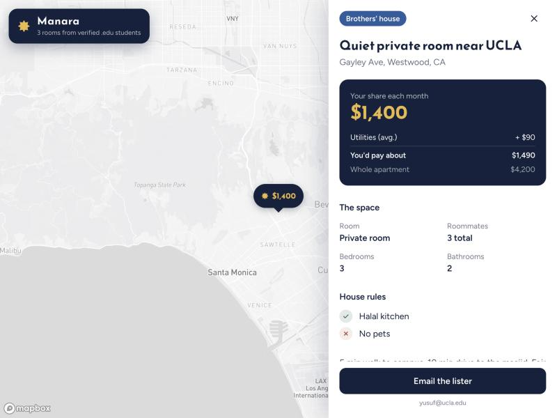

# Bayt Qareeb

*by Manara West*

**Find a roommate who shares your deen, on a map.**



Bayt Qareeb is a Zillow-style roommate finder for Muslim college students. Browse rooms on a full-screen map, tap a price pin, and see what matters: private or shared room, your actual share of the rent, average utilities, halal kitchen, pets, and whether the place is brothers-only or sisters-only.

## Anti-creep gate: `.edu` only

Only verified college emails (`*.edu`) can sign up. Everyone on the platform is a student, which keeps out scammers and strangers posing as roommates.

- Sign-in is handled by Clerk with an emailed one-time code, which proves the student owns the inbox.
- `lib/auth.ts` checks that the signed-in user's verified primary email ends in `.edu`. Anyone else sees a "Students only" screen, and `/api/listings` returns 403.

## Features
- Full-screen Mapbox map with price-tag pins
- Listing sidebar: room setup, capacity, total rent vs. your share, utilities, house rules
- Gender preference (brothers / sisters / any), halal kitchen, pets
- CI pipeline that blocks bad seed data (negative rent, rent > $10k, missing coordinates)

## Stack
Next.js 14 (App Router) · Prisma + Supabase Postgres · Clerk auth · react-map-gl + Mapbox · Tailwind CSS · GitHub Actions

## Run locally
```bash
npm install
cp .env.example .env        # then fill in Supabase, Clerk and Mapbox values
npx prisma db push
npm run seed
npm run dev
```
Open http://localhost:3000

Where the `.env` values come from:
- `DATABASE_URL` / `DIRECT_URL`: Supabase → Connect → ORMs → Prisma (transaction pooler on 6543 with `?pgbouncer=true`, session pooler on 5432)
- Clerk keys: Clerk dashboard → Configure → API keys
- Mapbox token: https://account.mapbox.com/access-tokens/

## Scripts
| Command | What it does |
|---|---|
| `npm run dev` | Start dev server |
| `npm run seed` | Load sample listings |
| `npm run validate` | Check seed data for outliers |
| `npm run build` | Production build |
