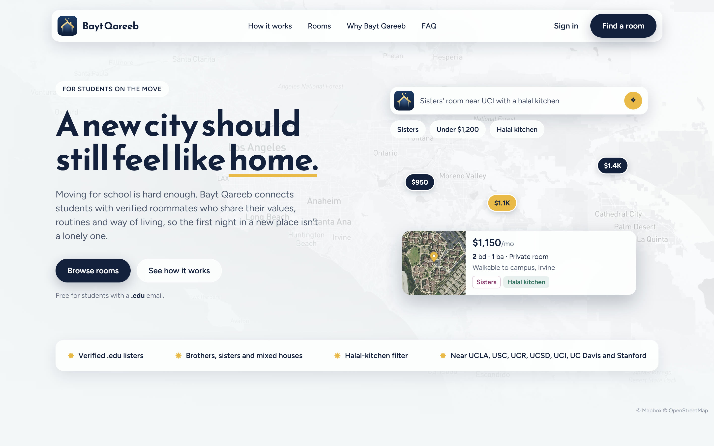
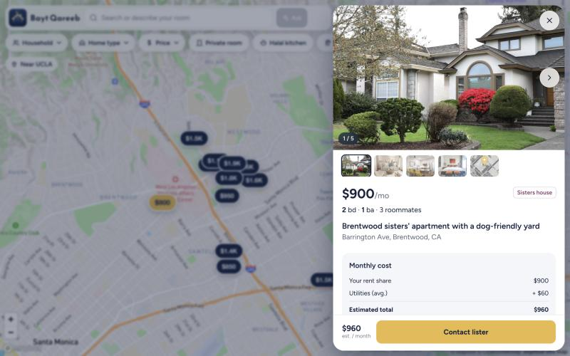
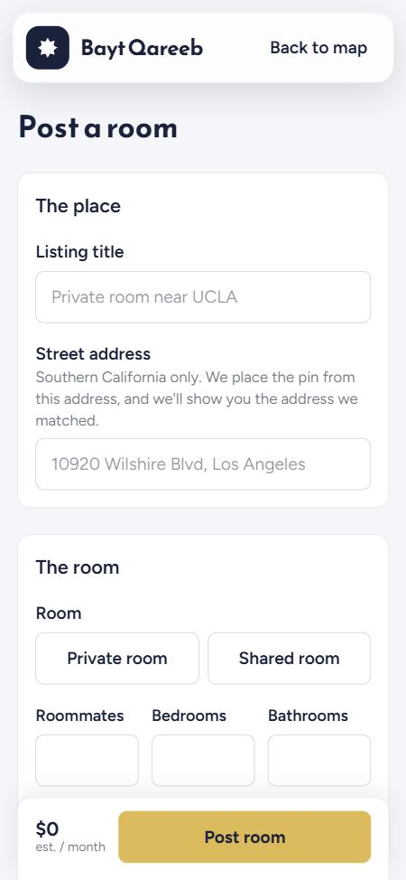
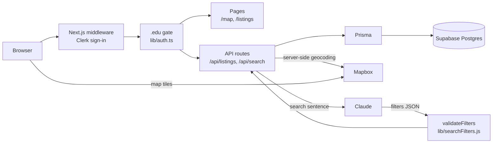

# Bayt Qareeb

**Find a room near campus with roommates who share your values.** A map-first housing and roommate finder for Muslim college students, open only to verified `.edu` students.

*By Manara West · Manara Network: Bridging Campuses track*

[](https://github.com/waleedA13/Bayt-Qareeb/actions/workflows/main.yml)


[](https://manara-west.vercel.app)
[](https://devpost.com/software/bayt-qareeb)
-0F1E3A)

---

## Demo

- **Live app:** https://manara-west.vercel.app
- **Video:** https://youtu.be/dgyNZPzzhyE
- **Devpost:** https://devpost.com/software/bayt-qareeb

| Landing page | Map with a room open | Posting a room (phone) |
|---|---|---|
|  |  |  |

### Try it (judges)

The app is `.edu`-only, so you need to sign in to see listings. Our Clerk instance is in development mode, which supports [Clerk test emails](https://clerk.com/docs/testing/test-emails-and-phones):

1. Open https://manara-west.vercel.app and choose **Open the map**
2. Sign up with `judge+clerk_test@ucla.edu` and enter the code `424242` (no email is sent)
3. The map opens on UCLA. Tap a price pin, open a room and swipe through its photos
4. Try the filters (**Household**, **Home type**, **Price**, **Halal kitchen**), or type a sentence like *sisters private room near UCI under $1,200* and press **Enter**

---

## The problem

Moving to a new campus means finding housing in an unfamiliar city, often with strangers, and usually through scattered group chats. That's especially true for transfer students. Muslim students also need things generic listing sites don't show: brothers-only or sisters-only houses, a halal kitchen, roommates who keep a similar routine. Bayt Qareeb puts those details on the map, and keeps everyone on it a verified student.

## What Bayt Qareeb does

1. **Landing page:** see what the app is for and choose **Open the map**
2. **Sign up with a `.edu` email:** Clerk sends a one-time code that proves you own the inbox
3. **The map opens on your campus:** UCLA, USC, UC Riverside, UCSD, UC Irvine, UC Davis or Stanford
4. **Filter or search:**
   - chips: household (brothers / sisters / mixed), home type, price range, private room, halal kitchen, pets
   - or type a sentence and the AI search sets the filters for you
   - searching a place flies the map there and lists every room in view
5. **Open a room:** see a photo tour, your share of the rent vs. the whole apartment, utilities and house rules, then **Contact lister**
6. **Or post a room:** add, edit and delete your own listings (up to 5)

## How it works



**AI search only fills in filters.** `/api/search` sends the search sentence to Claude with a fixed JSON schema (max rent, household, room type, home type, pets, halal kitchen, place). The response is run through `validateFilters`, which drops unknown keys and bad values. The app then applies those filters with the same logic the filter chips use. The model never sees listings, never returns listings, and can't write to the database.

## Safety and privacy

- **`.edu`-only, enforced on the server.** Middleware requires sign-in for every page except the landing and auth pages, and for every API route. Pages and APIs also check that the user's *verified* primary email ends in `.edu`. Anyone else gets a "Students only" screen, and the APIs return 403.
- **Signed-out visitors get no listing data.** The landing page uses static sample cards, with no addresses or emails.
- **Owner-only edits.** Edit and delete are enforced in the database query, so someone else's listing returns 404.
- **Server-trusted fields.** The contact email and owner always come from the signed-in account. Coordinates come from server-side geocoding, never from the client.
- **Row-level security** is on for the `Listing` and `User` tables, so Supabase's public Data API can't read them.
- **In CI:** gitleaks secret scan and CodeQL on every push and PR.
- **No analytics** or tracking scripts.

**Open items (known, not fixed yet):**
- Student-posted rooms show the full matched address and a satellite view of the block.
- There's no rate limit on geocoding or AI search.
- The 5-listing cap is a count-then-insert check, so two requests at the same moment could both get through.
- Posting a room only accepts Southern California addresses, even though the map also covers UC Davis and Stanford.
- Listing photos are free-license stock images, not the actual buildings.

## Verification

**On every push and pull request (GitHub Actions):**
- `npm run validate`: all 80 seed listings pass the same field rules as posted listings, sit within 5 miles of a campus, and use fake `@example.edu` contacts
- the 4 check scripts in `scripts/` (listing input, geocoding, search filters, campuses)
- `npm audit` (report-only until the Next.js 16 upgrade)
- a production build
- gitleaks and CodeQL

**Tested by hand, per the merged PRs:**
- Sign-in with a `.edu` Clerk test account loads the map (#20)
- Phone layouts at 375, 390 and 430px wide plus landscape: no horizontal overflow, tap targets at least 44px (#26)
- Post, edit and delete a room; live Mapbox geocoding with sample addresses (#27)
- Map UI, filters, price slider, place search, photo tour and home-type filter, using a local build with sign-in stubbed out (#22, #29)

**Not tested in a real signed-in browser session:** the full sign-up → map flow on the live site after #24, the "Students only" screen for a non-`.edu` account, and the AI search from the UI.

## Tech stack

| Layer | Technology | Version |
|---|---|---|
| Framework | Next.js (App Router) | 14.2.35 |
| UI | React | 18.3.1 |
| Styling | Tailwind CSS | 3.4.14 |
| Language | TypeScript | 5.6.3 |
| Map | Mapbox GL JS, react-map-gl | 3.7.0, 7.1.7 |
| Database | Prisma ORM + Supabase Postgres | 5.20.0 |
| Auth | Clerk (`@clerk/nextjs`) | 6.39.8 |
| AI search | Anthropic SDK (Claude Haiku) | 1.6.0 |
| CI/CD | GitHub Actions, Dependabot, Vercel | |

## Getting started

**Prerequisites:** Node.js 20+, npm, and free accounts for Supabase, Clerk, Mapbox and Anthropic.

```bash
git clone https://github.com/waleedA13/Bayt-Qareeb.git && cd Bayt-Qareeb
```
```bash
npm ci
```
```bash
cp .env.example .env
```

Fill in `.env`:

| Variable | Where it comes from |
|---|---|
| `DATABASE_URL` | Supabase → Connect → ORMs → Prisma (transaction pooler, port 6543, `?pgbouncer=true`) |
| `DIRECT_URL` | Same page (session pooler, port 5432), used by `prisma db push` |
| `NEXT_MAPBOX_TOKEN` | Mapbox → Access tokens (public `pk.` token; it reaches the browser because the map is drawn there) |
| `NEXT_CLERK_PUBLISHABLE_KEY` | Clerk → Configure → API keys |
| `CLERK_SECRET_KEY` | Same page (server only) |
| `ANTHROPIC_API_KEY` | Anthropic Console → API keys (server only, used by `/api/search`) |

The Clerk publishable key isn't named `NEXT_PUBLIC_*` because Vercel flags public variable names containing `KEY`. The app passes it to `ClerkProvider` and the middleware directly.

```bash
npx prisma db push
```
```bash
npm run seed
```
```bash
npm run dev
```

Open http://localhost:3000. `npm run seed` replaces only the seed listings; rooms that students posted (rows with an owner) are kept.

| Script | What it does |
|---|---|
| `npm run dev` | Start the dev server |
| `npm run build` | Production build |
| `npm run start` | Serve the production build |
| `npm run seed` | Load `prisma/seed-data.json` (keeps student-posted rooms) |
| `npm run validate` | Check every seed listing against the data rules |

## Project structure

```
app/          Routes: landing (/), map (/map), post and manage rooms (/listings), sign-in/up, API routes
components/   Shared UI: logo, map backdrop, auth page shell
lib/          Server and shared logic: .edu gate, campuses, geocoding, listing and search-filter validation, Prisma client
prisma/       Database schema, seed data (80 listings) and seed script
scripts/      Data validator and check scripts run in CI
docs/         Screenshots used in this README
.github/      CI workflow and Dependabot config
```

## Testing and CI

| Check | Command | Runs in |
|---|---|---|
| Seed data validation | `npm run validate` | CI, local |
| Listing input rules | `node scripts/check-listing-input.js` | CI, local |
| Geocoding rules | `node scripts/check-geocode.js` | CI, local |
| Search filter validation | `node scripts/check-search-filters.js` | CI, local |
| Campus lookup | `node scripts/check-campuses.js` | CI, local |
| Dependency audit | `npm audit --omit=dev --audit-level=high` | CI (report-only) |
| Production build | `npm run build` | CI, Vercel |
| Secret scan | gitleaks | CI |
| Static analysis | CodeQL (JavaScript/TypeScript) | CI |

CI runs with read-only permissions, pins every action to a commit SHA and doesn't keep the GitHub token after checkout. Vercel deploys `main` automatically.

## Documentation

- [README](README.md) (this file)
- [Screenshots](docs/screenshots/)
- [CI workflow](.github/workflows/main.yml)
- [Environment template](.env.example)
- [License](LICENSE)

## Roadmap

Not built yet:
- **Privacy for student-posted rooms:** approximate pin, hide the house number and the satellite image
- **Rate limiting** for geocoding, AI search and posting
- **Next.js 15/16 upgrade** (then make `npm audit` blocking)
- **More campuses** beyond California, and posting rooms near UC Davis and Stanford
- **Saved rooms**
- **In-app messaging** instead of email
- **Real photo uploads** by listers
- **A Clerk production instance** with its own domain

## Team

- **Waleed A**: the original MVP (Next.js app, Prisma schema, listings API, first `.edu` sign-up check), the CI pipeline and its hardening (least-privilege permissions, pinned actions, npm audit, gitleaks, CodeQL, Dependabot), the map UI through every version (sidebar, UI v2, glass UI, streets map), photo tours, home types and the logo ([@waleedA13](https://github.com/waleedA13))
- **Aditya Jadhav**: the move to Supabase Postgres with Clerk `.edu` sign-in and the AI search, the landing page and glass sign-in/sign-up, mobile fixes for the public pages, posting rooms, and the 80 campus listings with the campus-centered map ([@AdityaJadhav17](https://github.com/AdityaJadhav17), [portfolio](https://adityajadhav.dev/#project-bayt-qareeb))
- **Abas Mohamed**: a UI update to the map page ([@ver1log](https://github.com/ver1log))

## Acknowledgements

1. Map tiles, static maps and geocoding by [Mapbox](https://www.mapbox.com/), with data © [OpenStreetMap contributors](https://www.openstreetmap.org/copyright)
2. Listing photos from [Unsplash](https://unsplash.com/), used under the [Unsplash License](https://unsplash.com/license)
3. Authentication by [Clerk](https://clerk.com/), including [test emails](https://clerk.com/docs/testing/test-emails-and-phones) for the demo login
4. Database hosting by [Supabase](https://supabase.com/)

## Disclaimer

Bayt Qareeb is a hackathon project. It is not a landlord, broker or housing provider, and it doesn't verify listings beyond the lister's `.edu` email. Listings marked **"Demo listing"** are sample data with fake contacts. Not affiliated with any university. Nothing here is legal advice.

## License

[MIT](LICENSE) © 2026 Manara West
